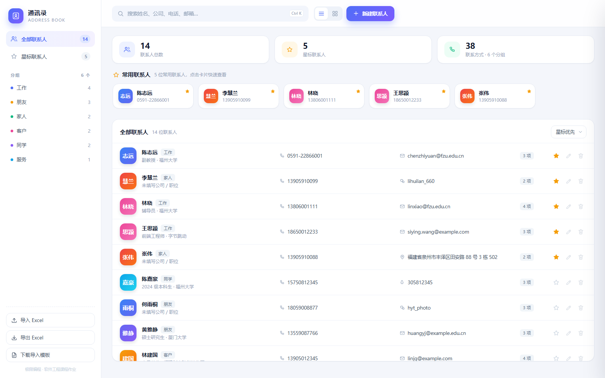
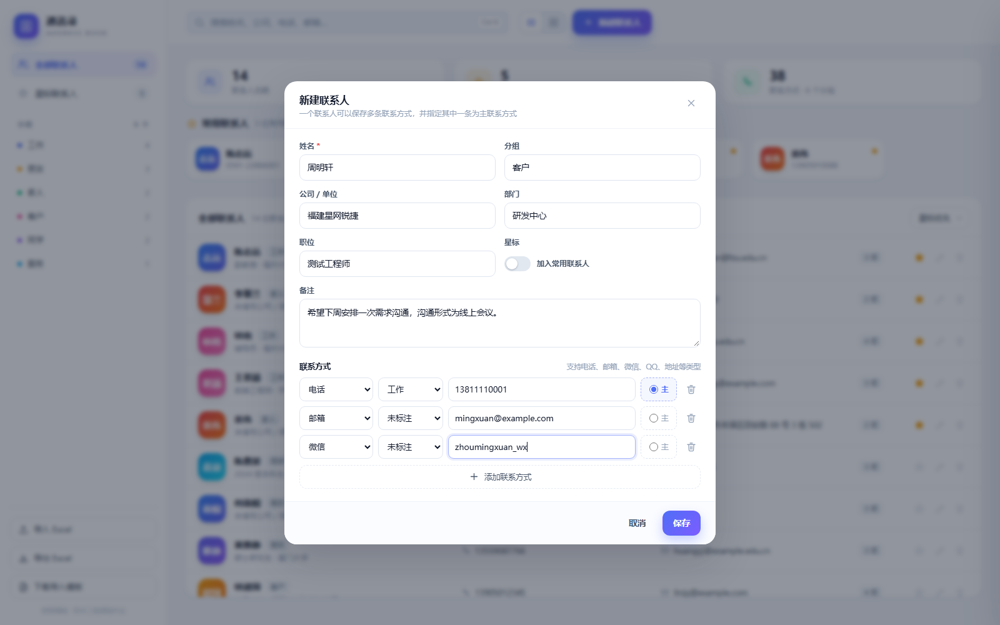
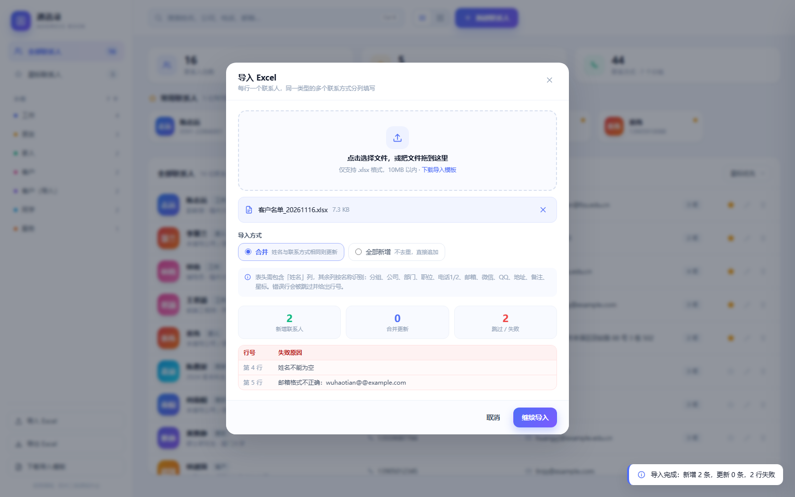

# 通讯录管理系统 · Address Book

> 软件工程（FZU–MU）极限编程作业：一个支持**星标常用联系人**、**多联系方式**、**Excel 导入导出**的通讯录 Web 应用。

前端使用原生 HTML / CSS / JavaScript，后端使用 Python + Flask + SQLite，无需前端构建工具，一条命令即可运行。



## 功能特性

| 功能 | 说明 |
| --- | --- |
| 星标（常用）联系人 | 一键收藏 / 取消收藏；顶部「常用联系人」快捷卡片；独立的星标筛选视图；列表默认星标优先排序 |
| 多联系方式 | 一个联系人可保存任意多条电话、邮箱、微信、QQ、地址、其他联系方式，可标注场景（工作/个人/家庭…）并指定唯一「主」联系方式 |
| Excel 导出 | 一行一个联系人、一类信息一列；同类多个联系方式自动扩展为「电话1/电话2…」；带表头样式、冻结窗格、筛选器、列宽自适应与「填写说明」页 |
| Excel 导入 | 自动识别表头别名、逐行校验、错误行给出行号与原因；支持「合并去重」与「全部新增」两种策略 |
| 检索与分组 | 姓名/公司/部门/职位/备注/分组/联系方式全文搜索；分组侧边栏统计；列表与卡片两种视图 |
| 页面体验 | 响应式布局、详情抽屉、复制联系方式、快捷键（Ctrl/⌘ + K 搜索、Esc 关闭）、空状态引导、操作 Toast 提示 |

## 技术栈

- **后端**：Python 3.10+、Flask 2.x、SQLite（WAL 模式）、openpyxl
- **前端**：原生 ES6、CSS 变量与 Grid/Flex 布局、内联 SVG 图标，无第三方运行时依赖
- **测试**：`unittest` + Flask `test_client`（13 个用例，覆盖接口、校验与 Excel 往返）
- **部署**：gunicorn + Nginx（Linux）或 Docker

## 界面预览

| 星标联系人（卡片视图） | 联系人详情（多联系方式） |
| --- | --- |
|  |  |

| 新建 / 编辑联系人 | 导入结果报告 |
| --- | --- |
|  |  |

> 更多截图见 [`docs/images`](docs/images)，完整开发过程与设计说明见 [`docs/blog.md`](docs/blog.md)。

## 快速开始

### 1. 安装依赖

```bash
cd address-book
python -m venv .venv

# Windows
.venv\Scripts\activate
# macOS / Linux
source .venv/bin/activate

pip install -r requirements.txt
```

### 2. 启动服务

```bash
python app.py                 # 默认 http://127.0.0.1:8000
python app.py --demo          # 首次启动写入 14 条演示联系人
python app.py --port 8123     # 指定端口
python app.py --host 0.0.0.0  # 允许局域网 / 公网访问
```

浏览器打开 <http://127.0.0.1:8000> 即可使用。数据库默认位于 `data/address_book.db`，可通过 `--db` 参数或环境变量 `ADDRESS_BOOK_DB` 指定。

也可以使用 Flask CLI 启动：

```bash
flask --app app run --port 8000
```

### 3. 体验导入导出

- 在页面左下角点击「下载导入模板」，按表头填写；
- 或直接导入仓库自带的示例文件 [`examples/示例通讯录.xlsx`](examples/示例通讯录.xlsx)；
- 点击「导出 Excel」可把当前筛选结果导出为 `.xlsx`。

## 目录结构

```
address-book/
├── app.py                  # 应用入口：应用工厂、命令行参数、演示数据
├── backend/
│   ├── api.py              # REST API 蓝图、统一错误处理
│   ├── contacts.py         # 仓储层：查询/写入/星标/批量导入、拼音排序
│   ├── db.py               # SQLite 连接管理与建表脚本
│   ├── excel_io.py         # Excel 导出样式与导入解析
│   ├── seed.py             # 演示数据
│   └── validation.py       # 字段校验与归一化
├── static/
│   ├── index.html          # 单页应用骨架 + SVG 图标集
│   ├── css/style.css       # 设计系统与响应式样式
│   └── js/app.js           # 状态管理、渲染、交互与路由
├── tests/test_api.py       # 后端单元测试
├── examples/示例通讯录.xlsx # 可直接导入的示例文件
├── docs/
│   ├── blog.md             # 作业博客（提交用）
│   ├── 编码规范.md
│   ├── 部署说明.md
│   └── images/             # 运行截图
├── data/                   # SQLite 数据文件（已 gitignore）
├── Dockerfile
└── requirements.txt
```

## API 一览

| 方法 | 路径 | 说明 |
| --- | --- | --- |
| GET | `/api/health` | 健康检查 |
| GET | `/api/meta` | 联系方式类型、场景标签、分组统计、总体统计 |
| GET | `/api/contacts?q=&starred=&group=&sort=` | 联系人列表（支持搜索、星标、分组、排序） |
| POST | `/api/contacts` | 新建联系人（含多条联系方式） |
| GET | `/api/contacts/<id>` | 联系人详情 |
| PUT | `/api/contacts/<id>` | 更新联系人（整体替换联系方式） |
| PATCH | `/api/contacts/<id>/star` | 设置 / 切换星标 |
| DELETE | `/api/contacts/<id>` | 删除联系人（级联删除联系方式） |
| GET | `/api/export?q=&starred=&group=` | 导出 xlsx（可导出当前筛选结果） |
| GET | `/api/template` | 下载导入模板 |
| POST | `/api/import` | 导入 xlsx，`mode=merge|insert` |

错误统一返回：`{"error": {"message": "...", "field": "..."}}`。

## Excel 导入导出规则

导出列（按实际数据动态扩展）：

```
姓名 | 分组 | 公司 | 部门 | 职位 | 电话1..n | 邮箱1..n | 微信 | QQ | 地址 | 其他 | 备注 | 星标 | 创建时间
```

导入规则：

1. 表头必须包含「姓名」列，其余列按别名识别：`名字/电话/手机/手机号/邮箱/邮件/微信/QQ/地址/住址/备注/星标` 等；
2. 一个联系人一行，同一类型的多个联系方式写在「电话1」「电话2」等不同列；也支持在单元格内用 `；、,` 分隔多个值；
3. 逐行校验：姓名必填，邮箱格式、电话位数、QQ 纯数字；错误行会被跳过并在页面报告中显示行号与原因；
4. `merge` 模式下，若姓名与全部联系方式都与已有记录一致，则合并更新（字段补全、联系方式去重）；`insert` 模式无条件新增。

## 测试

```bash
python -m unittest discover -s tests -v
```

覆盖：基础接口、多联系方式与主联系方式归一化、字段校验、星标切换与筛选、搜索与分组、更新与级联删除、导出表头结构、导出→导入幂等往返、导入错误行报告、非法文件拒绝、模板下载、按分组导出、拼音排序。

## 部署

本地、云服务器（阿里云 / 华为云）、Docker 三种方式见 [`docs/部署说明.md`](docs/部署说明.md)。

```bash
# Docker
docker build -t address-book .
docker run -d -p 8000:8000 -v $(pwd)/data:/data --name address-book address-book
```

## 常见问题

**Q：端口被占用？** 使用 `python app.py --port 8123` 换端口，或结束占用 8000 端口的进程。

**Q：导入提示「仅支持 .xlsx」？** 老版 `.xls` 需要先用 Excel / WPS 另存为 `.xlsx`。

**Q：想重置数据？** 停止服务后删除 `data/address_book.db`（含 `-wal`、`-shm`），重新执行 `python app.py --demo`。

**Q：数据会丢吗？** 全部数据保存在本地 SQLite 文件中，容器部署时请务必挂载 `/data` 卷。

## 开发约定

提交信息、命名、注释与代码风格约定见 [`docs/编码规范.md`](docs/编码规范.md)。

## License

[MIT](LICENSE)
