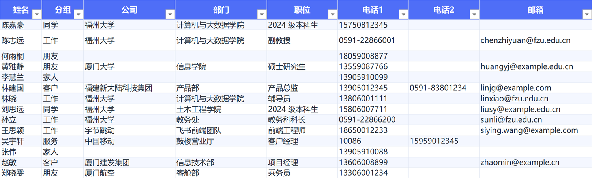
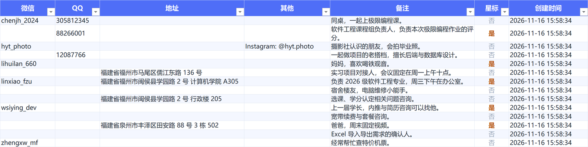
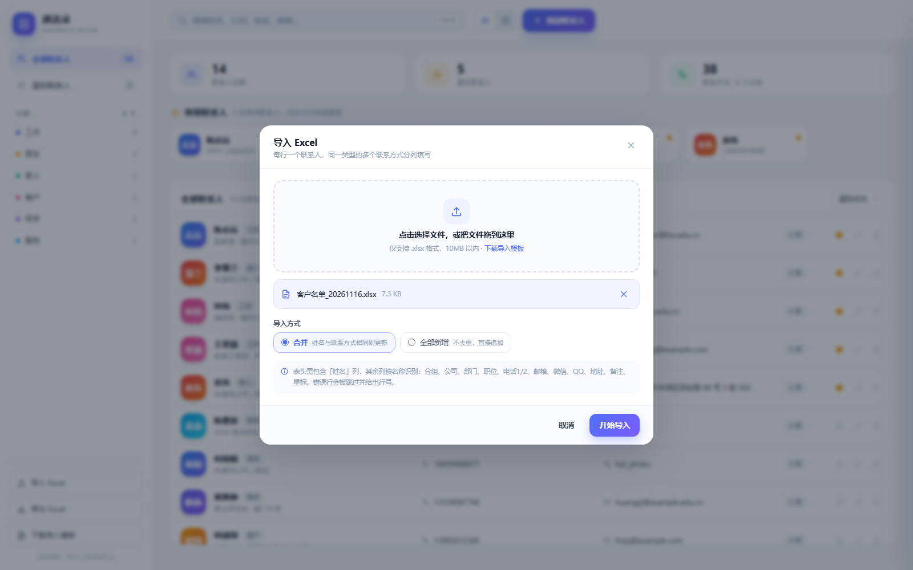
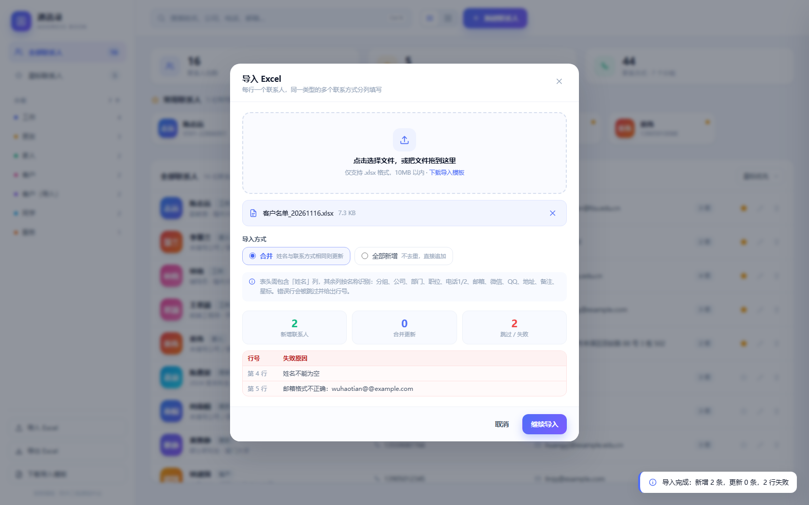
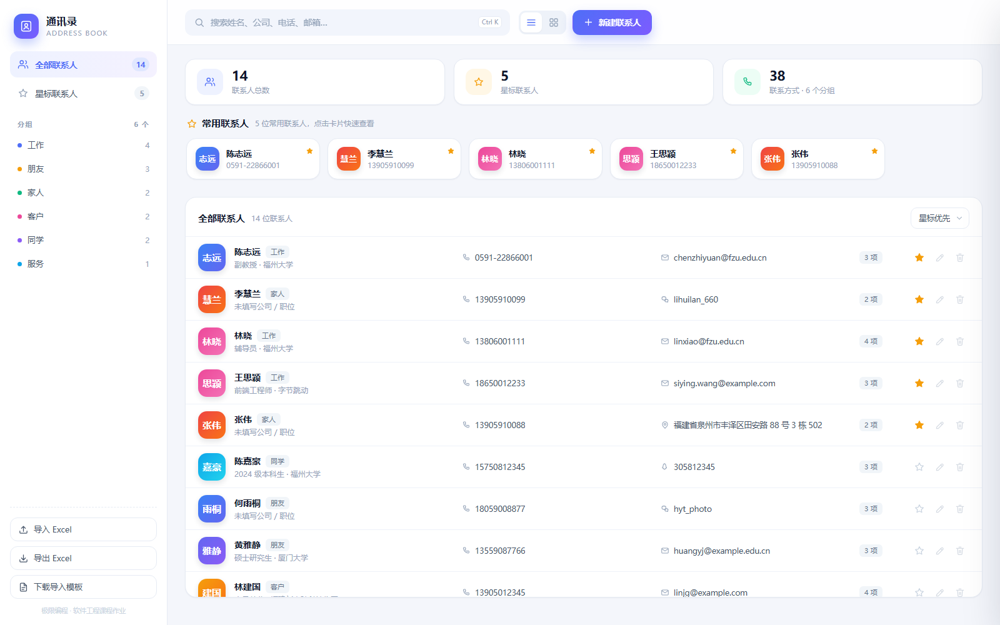
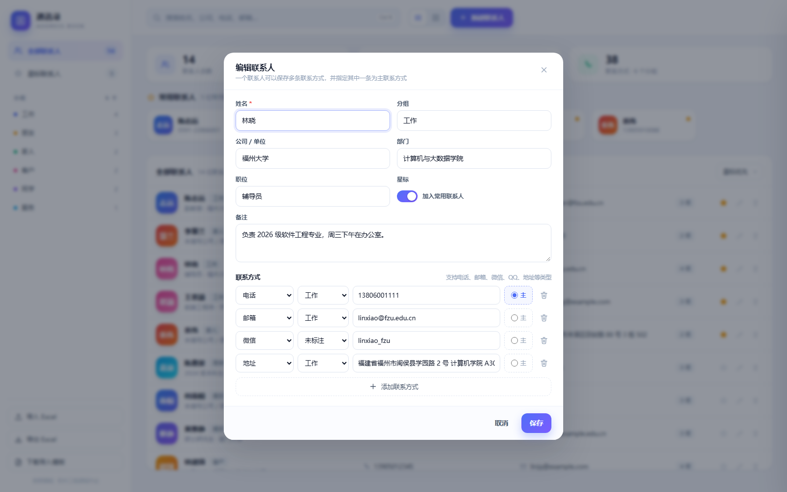
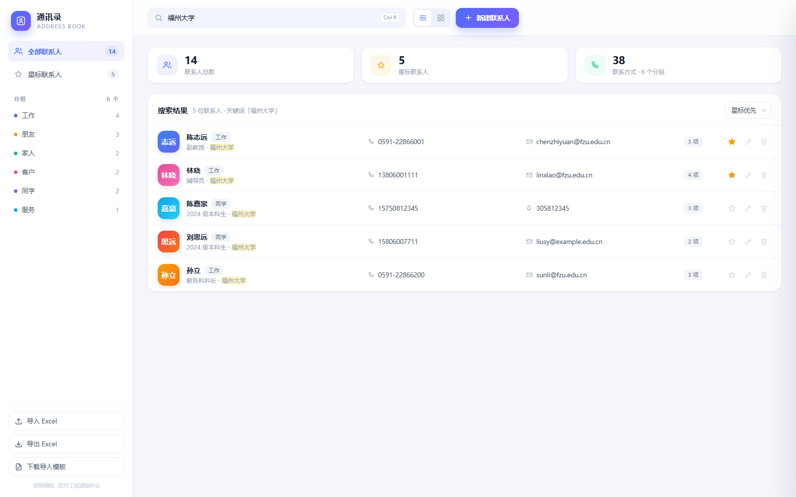
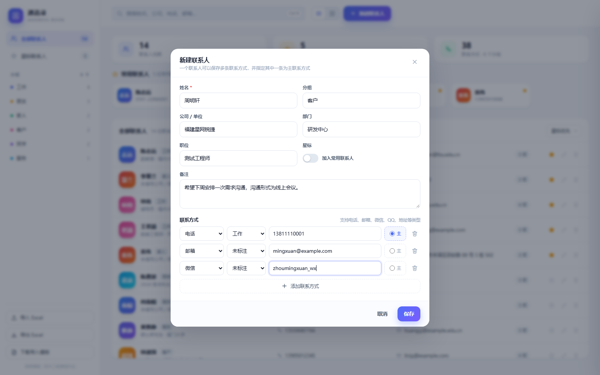
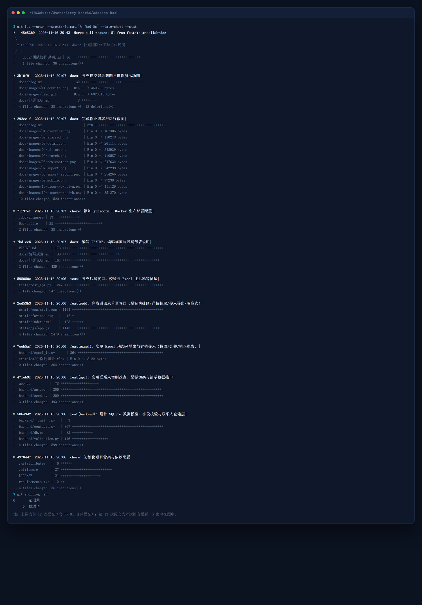

# 极限编程作业：通讯录管理系统（Address Book）

| 项目 | 内容 |
| --- | --- |
| 本次作业所属课程 | 软件工程（FZU–MU） |
| 队伍名称 | Address Book Team（蔡耀华 832401302 · 左项荣 832401230） |
| 作业要求 | [Extreme Programming（Deadline: November 17, 2026 23:59）](https://bbs.csdn.net/topics/620593436) |
| 本次作业目标 | 以极限编程的小步迭代方式，完成一个可实际使用的通讯录 Web 应用：支持星标常用联系人、一个联系人多条联系方式、Excel 导入导出，并完成仓库管理、测试、部署与文档；在编码过程中练习模块划分、代码规范与持续提交 |
| 其他参考 | [Flask 官方文档](https://flask.palletsprojects.com/)、[openpyxl 文档](https://openpyxl.readthedocs.io/)、[MDN Web Docs](https://developer.mozilla.org/) |

<!--
说明：GitHub 仓库地址已填写；如后续完成云端部署，把公网地址补充到第一节「云端访问地址」即可（可选加分项）。
-->

## 目录

- [一、项目地址](#一项目地址)
- [二、作业要求与完成情况对照](#二作业要求与完成情况对照)
- [三、需求分析与模块设计](#三需求分析与模块设计)
  - [3.1 功能清单](#31-功能清单)
  - [3.2 模块划分](#32-模块划分)
  - [3.3 数据模型](#33-数据模型)
  - [3.4 接口设计](#34-接口设计)
- [四、功能实现思路](#四功能实现思路)
  - [4.1 星标（常用）联系人](#41-星标常用联系人)
  - [4.2 一个联系人，多条联系方式](#42-一个联系人多条联系方式)
  - [4.3 Excel 导出](#43-excel-导出)
  - [4.4 Excel 导入](#44-excel-导入)
  - [4.5 页面样式与交互细节](#45-页面样式与交互细节)
  - [4.6 两个实现细节：拼音排序与搜索高亮](#46-两个实现细节拼音排序与搜索高亮)
  - [4.7 安全与健壮性](#47-安全与健壮性)
- [五、程序运行截图](#五程序运行截图)
- [六、部署](#六部署)
- [七、测试](#七测试)
- [八、Git 提交记录](#八git-提交记录)
- [九、分工与贡献比](#九分工与贡献比)
- [十、开发与协作中遇到的困难与解决](#十开发与协作中遇到的困难与解决)
- [十一、PSP 表](#十一psp-表)
- [十二、总结与改进方向](#十二总结与改进方向)

---

## 一、项目地址

| 项目 | 地址 |
| --- | --- |
| GitHub 仓库 | `https://github.com/Betty-bear86/address-book` |
| 代码规范文档 | [`docs/编码规范.md`](https://github.com/Betty-bear86/address-book/blob/main/docs/编码规范.md) |
| 本地运行地址 | `http://127.0.0.1:8000`（`python app.py`） |
| 云端访问地址 | 未部署（可选加分项，部署步骤见第六节，约 10 分钟） |
| Release 版本 | [v1.0.0](https://github.com/Betty-bear86/address-book/releases/tag/v1.0.0) |
| Pull Request | [PR #1 · 团队分工与协作说明](https://github.com/Betty-bear86/address-book/pull/1) |
| 团队协作说明 | [`docs/团队协作说明.md`](https://github.com/Betty-bear86/address-book/blob/main/docs/团队协作说明.md) |
| 作业提交帖（CSDN） | https://bbs.csdn.net/topics/620594840 |
| 示例导入文件 | [`examples/示例通讯录.xlsx`](https://github.com/Betty-bear86/address-book/blob/main/examples/示例通讯录.xlsx) |

## 二、作业要求与完成情况对照

| 作业要求 | 分值 | 完成情况 | 实现位置 |
| --- | --- | --- | --- |
| 博客格式（Markdown）、GitHub 仓库链接与代码规范链接 | 10 | ✅ 本文即 Markdown；仓库与规范链接见第一节 | `docs/blog.md`、`docs/编码规范.md` |
| 功能实现思路、程序截图、分工说明 | 20 | ✅ 第四、五、九节 | 本文 |
| 页面样式 | 10 | ✅ 完整设计系统、响应式、抽屉/弹窗/Toast/空状态 | `static/css/style.css` |
| 书签（星标）联系人 | 25 | ✅ 一键星标、快捷卡片区、独立筛选视图、星标优先排序 | `backend/contacts.py`、`static/js/app.js` |
| 添加多个联系方式 | 10 | ✅ 6 种类型、任意条数、场景标签、唯一主联系方式 | `backend/validation.py`、编辑弹窗 |
| 导入与导出 | 25 | ✅ 动态列导出（含样式与说明页）、导入校验与错误报告、合并/新增策略 | `backend/excel_io.py` |
| Web 部署（可选） | +15 | ⚠️ 未部署到云服务器；已提供 Dockerfile、systemd + Nginx 完整步骤 | `Dockerfile`、`docs/部署说明.md` |
| 模块划分、团队参与、仓库提交 ≥ 3 次 | — | ✅ 13 次提交、PR #1、v1.0.0 Release、两人协作完成全部编码 | 第八节 |

## 三、需求分析与模块设计

### 3.1 功能清单

从「通讯录」这一日常工具出发，我把需求拆成三类用户动作：

1. **快速找到常用的人**——星标收藏 + 顶部快捷区 + 星标筛选 + 全文搜索；
2. **把一个人的所有联系方式记全**——电话、邮箱、微信、QQ、地址、其他，且能区分「工作/个人/家庭」并标记主联系方式；
3. **和 Excel 互通**——把通讯录导出成规范的表格备份/分享，也能把别人给的表格批量导入。

对应的主要用例：

| 用例 | 参与者 | 主流程 |
| --- | --- | --- |
| 新建联系人 | 用户 | 填写姓名/分组/公司等 → 添加 ≥1 条联系方式 → 保存 |
| 星标联系人 | 用户 | 在列表/详情/快捷卡片上点击星标 → 状态即时切换 → 出现在「常用联系人」 |
| 查看详情 | 用户 | 点击联系人 → 右侧抽屉展示全部联系方式、备注与记录时间 |
| 搜索/筛选 | 用户 | 输入关键词（姓名/公司/电话/邮箱/备注）或点击分组 → 列表实时过滤 |
| 导出 | 用户 | 选择筛选条件 → 点击导出 → 下载 `.xlsx` |
| 导入 | 用户 | 下载模板 → 填写 → 上传 → 选择合并/新增 → 查看导入报告 |

### 3.2 模块划分

项目按「入口 → 接口 → 业务 → 存储」分层，前端只有一个页面，但内部按状态/渲染/交互拆成独立函数，便于定位问题。

```
                    ┌──────────────────────────────────────┐
  浏览器  ──────────▶│ static/index.html  页面骨架 + 图标集  │
                    │ static/css/style.css 设计系统/响应式  │
                    │ static/js/app.js  状态·渲染·交互·路由 │
                    └───────────────┬──────────────────────┘
                                    │ fetch JSON / multipart
                    ┌───────────────▼──────────────────────┐
                    │ backend/api.py   REST 路由 + 错误处理 │
                    └───────┬───────────────────┬──────────┘
                            │                   │
             ┌──────────────▼─────┐   ┌─────────▼─────────────┐
             │ backend/contacts.py│   │ backend/excel_io.py   │
             │ 仓储：查询/写入/导入 │   │ 导出样式 / 导入解析    │
             └──────────┬─────────┘   └─────────┬─────────────┘
                        │                       │
             ┌──────────▼───────────────────────▼──────────┐
             │ backend/validation.py 校验归一化             │
             │ backend/db.py  SQLite 连接、建表、事务       │
             └─────────────────────────────────────────────┘
```

| 模块 | 职责 | 关键设计 |
| --- | --- | --- |
| `app.py` | 应用工厂、命令行参数、演示数据 | `create_app(db_path)` 便于测试注入临时库 |
| `backend/db.py` | 连接、建表、事务上下文 | 每请求独立连接，WAL + `foreign_keys=ON` |
| `backend/validation.py` | 字段裁剪、类型转换、格式校验 | 校验与业务解耦，导入/接口共用同一套规则 |
| `backend/contacts.py` | 联系人仓储、星标、批量导入 | SQL 参数化；拼音排序；导入去重键 |
| `backend/excel_io.py` | 导出列规划与样式、导入表头识别与逐行校验 | 一份代码同时支持「导出→再导入」往返 |
| `backend/api.py` | REST 接口、统一错误响应 | 蓝图 + 异常处理器，返回结构一致 |
| `static/js/app.js` | 前端状态、渲染、事件委托、哈希路由 | 无框架，纯函数渲染 + 集中式 `state` |
| `tests/test_api.py` | 接口与 Excel 往返测试 | `unittest` + `test_client`，临时数据库 |

### 3.3 数据模型

联系人与其联系方式是典型的一对多关系，因此拆成两张表，而不是在联系人表里堆 `phone1/phone2/email1...` 字段——后者会让「加一个联系方式」变成改表结构。

```sql
CREATE TABLE contacts (
    id          INTEGER PRIMARY KEY AUTOINCREMENT,
    name        TEXT    NOT NULL,
    group_name  TEXT    NOT NULL DEFAULT '',
    company     TEXT    NOT NULL DEFAULT '',
    department  TEXT    NOT NULL DEFAULT '',
    title       TEXT    NOT NULL DEFAULT '',
    note        TEXT    NOT NULL DEFAULT '',
    starred     INTEGER NOT NULL DEFAULT 0,      -- 0/1 星标
    created_at  TEXT    NOT NULL,
    updated_at  TEXT    NOT NULL
);

CREATE TABLE contact_methods (
    id         INTEGER PRIMARY KEY AUTOINCREMENT,
    contact_id INTEGER NOT NULL REFERENCES contacts(id) ON DELETE CASCADE,
    type       TEXT    NOT NULL,                 -- phone/email/wechat/qq/address/other
    label      TEXT    NOT NULL DEFAULT '',      -- 工作/个人/家庭/学校
    value      TEXT    NOT NULL,
    is_primary INTEGER NOT NULL DEFAULT 0,       -- 每个联系人唯一
    sort_order INTEGER NOT NULL DEFAULT 0
);
```

设计要点：

- `contact_methods.contact_id` 外键带 `ON DELETE CASCADE`，删联系人自动清理联系方式，避免脏数据；
- `is_primary` 由后端强制归一化（有且仅有一条），前端用单选按钮表达；
- `sort_order` 保留用户录入顺序，详情页与导出都按此顺序展示。

### 3.4 接口设计

| 方法 | 路径 | 说明 |
| --- | --- | --- |
| GET | `/api/contacts?q=&starred=&group=&sort=` | 列表；`q` 同时匹配姓名、公司、部门、职位、备注、分组与任意联系方式 |
| POST | `/api/contacts` | 新建，返回完整对象（含生成的 id 与联系方式 id） |
| PUT | `/api/contacts/<id>` | 更新，联系方式整体替换（简单、无脏行） |
| PATCH | `/api/contacts/<id>/star` | 设置或切换星标，返回最新对象 |
| DELETE | `/api/contacts/<id>` | 删除，级联删除联系方式 |
| GET | `/api/export` | 按当前筛选条件导出 xlsx |
| GET | `/api/template` | 下载带示例行与说明页的导入模板 |
| POST | `/api/import` | 上传 xlsx，`mode=merge` 合并去重 / `mode=insert` 全部新增 |

统一错误结构 `{"error": {"message": "邮箱格式不正确：xxx", "field": "methods"}}`，前端直接弹出 `message`，无需根据状态码猜原因。

## 四、功能实现思路

### 4.1 星标（常用）联系人

**数据层**：`contacts.starred` 一个 0/1 字段，配合 `idx_contacts_starred(starred DESC, name)` 索引。之所以不单独建「收藏表」，是因为星标是联系人的一个属性，单字段足以表达，查询与更新都更简单。

**接口层**：`PATCH /api/contacts/<id>/star` 同时支持显式设置与取反：

```python
@api.patch("/contacts/<int:contact_id>/star")
def star_contact(contact_id: int):
    payload = request.get_json(silent=True) or {}
    value = to_bool(payload["starred"]) if "starred" in payload else not store().get(contact_id)["starred"]
    return jsonify(store().set_starred(contact_id, value))
```

**交互层**：点击星标时先本地翻转、立即重绘（乐观更新），再发请求；失败则回滚并提示，保证手感和数据一致：

```javascript
async function toggleStar(contact) {
  const next = !contact.starred;
  contact.starred = next;          // 先改本地状态，界面立刻响应
  renderAll();
  try {
    Object.assign(contact, await api(`/contacts/${contact.id}/star`,
      { method: 'PATCH', body: { starred: next } }));
    renderAll();
  } catch (error) {
    contact.starred = !next;       // 失败回滚
    renderAll();
    toast(error.message, 'error');
  }
}
```

**界面上的三处入口**（互相独立但数据同步）：

1. 列表每一行的星标按钮，金色实心 = 已星标；
2. 详情抽屉的「设为星标 / 取消星标」；
3. 「全部联系人」页顶部的**常用联系人快捷卡片**（横向滚动，最多 8 位），星标后立即出现在这里，这是「快速访问」的核心体验。

侧边栏「星标联系人」显示实时计数，点击进入独立的星标视图，并支持卡片/列表两种浏览方式。

### 4.2 一个联系人，多条联系方式

**为什么用子表**：作业要求「允许一个联系人关联多个联系方式」，如果按 `phone1/phone2/email1...` 建列，每增加一类联系方式就要改表、改接口、改 Excel 列。用 `contact_methods` 子表后，新增类型只是多一个枚举值。

**校验与归一化**（`backend/validation.py`）：接口与 Excel 导入共用同一个 `normalize_contact()`，保证两条入口写出的数据完全一致：

```python
METHOD_TYPES = ("phone", "email", "wechat", "qq", "address", "other")

def normalize_contact(payload):
    methods = normalize_methods(payload.get("methods"))
    # 电话：字符集 + 5~20 位数字；邮箱：正则；QQ：纯数字
    # 去重（同类型同值）、最多 20 条、有且仅有一个 primary
    return {"name": ..., "group": ..., "methods": methods}
```

具体规则：

- 同一条联系人的同类型同值只保留一条（避免用户重复添加同一号码）；
- 若用户没有指定主联系方式，默认第一条为主；若指定了多条，只保留第一条；
- 类型不合法（如 `fax`）、电话位数不对、邮箱格式错误都会返回 400 并指出字段。

**前端表单**：联系方式是「可增删的行」，每行包含类型下拉、场景下拉、内容输入、主联系方式单选、删除按钮；新增行默认「其他」类型并自动聚焦，最多 20 行。保存时跳过空行，因此用户可以随便点「添加」再留空。

**展示**：详情抽屉按类型排序（电话 → 邮箱 → 微信 → QQ → 地址 → 其他）逐条展示，带类型图标、场景标签、主联系方式徽标与一键复制按钮；地址这类长文本自动换行。

### 4.3 Excel 导出

**列设计**。作业要求「每个联系人占一行、每类信息占一列」。难点在于「同类多个联系方式」：我的方案是**按实际数据动态决定列数**，同一类型依次占用「电话1、电话2、电话3…」，其余列固定：

```
姓名 | 分组 | 公司 | 部门 | 职位 | 电话1..n | 邮箱1..n | 微信1..n | QQ1..n | 地址1..n | 其他 | 备注 | 星标 | 创建时间
```

这样既满足「一类信息一列」，又保证「导出 → 修改 → 再导入」可以无损往返（导入时按表头数字顺序还原为多条联系方式）。若某类只有一条，列名直接是「电话」而不是「电话1」，更接近日常表格习惯。

**样式**。导出不是简单 `DataFrame.to_excel`，而是用 openpyxl 做了可读性处理：

- 表头深蓝底白字、居中、行高 26、冻结首行、自动筛选；
- 数据行隔行浅蓝底、细边框、垂直居中，备注与地址自动换行；
- 列宽按内容宽度自适应（中文按 2 个字符宽度计算），并限制最大 42；
- 「星标」列是「是/否」，并用下拉数据校验约束取值，`是` 用琥珀色加粗突出；
- 第二个工作表「填写说明」写清表头规则、多值分隔符、星标取值等，降低他人填错的可能。

**筛选导出**：`/api/export` 接受与列表相同的 `q/starred/group` 参数，因此「只看家人分组」时导出的就是该分组，而不是全量数据。

| 导出左半部分（姓名~邮箱） | 导出右半部分（微信~创建时间） |
| --- | --- |
|  |  |

### 4.4 Excel 导入

导入是本次作业里最容易「翻车」的部分，我按「识别 → 解析 → 校验 → 落库 → 报告」五步实现。

**① 识别表头（容错）**。用户拿到的表格往往不是我们导出的那一份：可能叫「手机」而不是「电话」，可能是「邮箱/邮件/E-mail」，也可能带序号列。因此维护了一张别名表，并把表头归一化：去空格、转小写、去掉括号备注、去掉末尾数字。

```python
HEAD_ALIASES = {"name": ("姓名", "名字", "联系人", "name", ...), ...}
TYPE_ALIASES = {"phone": ("电话", "手机", "手机号", "联系电话", "phone", ...), ...}

def _canonical(value):
    text = re.sub(r"\s+", "", str(value).lower())
    text = re.sub(r"[（(].*?[)）]", "", text)
    return re.sub(r"\d+$", "", text)      # 电话1 -> 电话
```

只有「姓名」列是硬性要求；找不到姓名列时抛出明确错误「未找到表头：第一行需要包含「姓名」列，请使用模板填写」。表头行会在前 10 行内自动探测，因此文件顶部即使有标题行也能导入。

**② 解析单元格**。一个单元格内用 `；、,` 分隔多个号码时自动拆分（地址列不拆，避免把「XX 路 3 号，2 栋」拆坏）；Excel 里被存成数字的手机号通过 `float.is_integer()` 还原为整数文本，避免出现 `13800000000.0`。

**③ 逐行校验**。每行交给与接口相同的 `normalize_contact()`；失败的行记录 `{"row": 行号, "message": 原因}` 后跳过，不影响其他行：

```python
try:
    clean = normalize_contact(payload)
except ValidationError as exc:
    errors.append({"row": row_number, "message": exc.message})
    continue
```

**④ 合并去重**。`merge` 模式用「姓名 + 全部联系方式」构造去重键：

```python
def contact_key(name, methods):
    values = sorted(f"{m['type']}:{m['value'].strip().lower()}" for m in methods)
    return f"{name.strip().lower()}|" + "|".join(values)
```

命中已有联系人时做**合并更新**：新记录里为空的字段保留旧值，联系方式取并集（同类型同值只留一条），星标取「或」。这样「导出 → 在 Excel 里补一个邮箱 → 再导入」不会产生重复联系人。`insert` 模式则无条件新增，适合导入一批全新名单。

**⑤ 导入报告**。接口返回 `{total, imported, updated, failed, errors[]}`，前端用三色统计卡 + 错误表格展示，错误行显示 Excel 真实行号，用户可以直接回到表格定位修改。





### 4.5 页面样式与交互细节

页面风格是「浅色 + 蓝紫渐变」的现代后台工具风，主要考虑：

- **信息密度**：列表行同时展示头像、姓名、分组、公司/职位、电话、第二联系方式与操作按钮，一屏能看到 10+ 人；
- **视觉层级**：白色卡片浮在浅灰背景上，弱化分割线，用字重和颜色区分主次；
- **即时反馈**：所有异步操作都有 Toast；星标、筛选、搜索都是即时生效；保存后自动打开详情，确认数据落库；
- **可访问性**：列表行支持 Tab 聚焦与 Enter 打开；弹窗支持 Esc 关闭；`prefers-reduced-motion` 下关闭动画；
- **响应式**：≥1180px 显示完整表格列，≥980px 收起侧边栏为抽屉菜单，<720px 隐藏次要列、卡片单列，手机上仍可完成新建/星标/导入；
- **空状态**：无联系人、无星标、无搜索结果、分组为空都有对应文案和操作入口，而不是一片空白。

键盘快捷键：`Ctrl/⌘ + K` 聚焦搜索、`Esc` 逐层关闭弹窗/抽屉、搜索框内 `Esc` 清空关键词。

### 4.6 两个实现细节：拼音排序与搜索高亮

**拼音排序**。中文用户习惯按拼音找联系人，而 SQLite 的 `ORDER BY name` 依据 Unicode 码位，会把「张」排在「陈」前面。GB2312 的一级汉字本身就是按拼音排列的，因此可以把姓名编码成 GBK 字节作为排序键，无需引入拼音词库：

```python
def pinyin_key(text: str) -> bytes:
    try:
        return text.encode("gbk")
    except UnicodeEncodeError:
        return text.encode("utf-8")
```

前端列表使用浏览器内置的 `localeCompare(..., 'zh-Hans-CN')`（Chrome 已实现拼音排序），服务端导出使用 `pinyin_key`，两者顺序一致。

**搜索高亮**。`highlight()` 先对文本做 HTML 转义，再对转义后的关键词做不区分大小写的包裹，既避免 XSS，也避免「用户输入 `<script>` 被当成标签」。

### 4.7 安全与健壮性

| 风险 | 处理 |
| --- | --- |
| SQL 注入 | 全部使用 `?` 参数化；`LIKE` 对 `%`、`_`、`\` 转义并声明 `ESCAPE` |
| XSS | 所有动态文本经 `escapeHtml()`/`highlight()`；不使用 `eval`/`innerHTML` 拼接未转义数据 |
| 恶意文件 | 只接受 `.xlsx/.xlsm`，限制 10MB，解析失败给出友好提示而不是 500 |
| 超长输入 | 姓名 40、短文本 60、备注 500、联系方式 120 字符，超出即 400 |
| 误删除 | 删除联系人前弹出二次确认，明确说明会连同联系方式一起删除 |
| 并发写 | SQLite 开启 WAL 与 `busy_timeout`，写操作放在事务中 |

## 五、程序运行截图

**① 主界面**：统计卡 + 常用联系人快捷区 + 列表视图，星标联系人有金色标识。



**② 星标联系人视图（卡片）**：只展示星标联系人，卡片上直接可见主要联系方式。


**③ 联系人详情抽屉**：4 条联系方式按类型排列，主联系方式有「主」徽标，可一键复制。


**④ 编辑联系人**：多联系方式行可增删，单选按钮指定主联系方式。



**⑤ 搜索**：关键词会同时匹配姓名、公司与联系方式，并高亮命中片段。



**⑥ 新建联系人**：填写姓名、分组、公司信息，添加电话/邮箱/微信三条联系方式。



**⑦⑧ 导入与导入报告**：选择文件、选择合并策略、查看新增/更新/失败统计与错误行号。


**⑨ 移动端适配**（430px 宽）：


**⑩ 导出文件在 Excel 中打开**：表头冻结、筛选器、列宽自适应、星标列着色、「填写说明」工作表。


> 完整操作演示动图见 [`images/demo.gif`](images/demo.gif)（约 12 秒，依次演示：打开详情 → 切换星标 → 星标视图 → 新建联系人 → 导入 Excel → 查看导入报告 → 导出）。提交到 CSDN 时可另录一段屏幕视频作为「完整运行视频」，动图用于快速预览。

## 六、部署

本地运行只需三步：

```bash
pip install -r requirements.txt
python app.py --demo
# 打开 http://127.0.0.1:8000
```

**云端部署（加分项）**：本次未购买云服务器，但已完成全部部署准备，购买后约 10 分钟可上线：

1. `Dockerfile` 使用 gunicorn（2 worker）+ `/data` 数据卷，`docker build` 后一条命令启动；
2. [`docs/部署说明.md`](https://github.com/Betty-bear86/address-book/blob/main/docs/部署说明.md) 提供 Ubuntu + systemd + Nginx 的完整命令与配置片段；
3. 数据库路径通过环境变量 `ADDRESS_BOOK_DB` 外置，容器重建不丢数据；
4. 部署完成后将公网地址填写到本文第一节「云端访问地址」。

## 七、测试

后端使用 `unittest` + Flask `test_client`，共 **13 个用例**，全部通过：

```text
$ python -m unittest discover -s tests -v
test_health_and_empty_meta ... ok
test_create_and_get_contact_with_multiple_methods ... ok
test_validation_errors ... ok
test_contacts_sorted_by_pinyin ... ok
test_star_toggle_and_filters ... ok
test_search_and_group_filter ... ok
test_update_replaces_methods_and_delete ... ok
test_export_headers_and_structure ... ok
test_export_import_round_trip_is_idempotent ... ok
test_import_insert_mode_and_row_errors ... ok
test_import_rejects_bad_file ... ok
test_template_download ... ok
test_export_respects_group_filter ... ok
----------------------------------------------------------------------
Ran 13 tests in 2.8s
OK
```

除了单元测试，我们还用无头浏览器（Edge + Chrome DevTools Protocol）跑了一遍真实交互的验收脚本，覆盖 12 个检查点：列表渲染、新建（含两条联系方式）、搜索、打开抽屉、星标切换、编辑、删除确认、导入（2 条合法 + 2 条非法行）、导入后列表刷新、导出接口、星标筛选、分组渲染——全部通过。这一层最直接地验证了「用户点得动、数据存得对」。

**导出一致性**：`test_export_import_round_trip_is_idempotent` 把导出的文件直接再导入，断言 `imported=0, updated=2`、总数不变，即往返不产生重复数据。

## 八、Git 提交记录

仓库按「骨架 → 后端 → 接口 → Excel → 前端 → 测试 → 文档 → 容器化 → 博客 → 协作文档」的顺序小步提交，共 **13 次提交**（含 1 个 Pull Request 合并提交）。提交信息统一使用 `type(scope): subject`，功能分支 `feat/team-collab-doc` 通过 **PR #1** 合入 `main`，并在合入后发布 **v1.0.0**。



| 成员 | 学号 | 提交次数 | 主要负责的提交 |
| --- | --- | --- | --- |
| 蔡耀华 | 832401302 | 7 | 项目骨架、前端页面与交互、README/编码规范、博客与截图、PR 合并提交 |
| 左项荣 | 832401230 | 6 | 数据模型与仓储、REST 接口、Excel 导入导出、单元测试、Docker 部署、团队协作文档 |
| **合计** | — | **13** | — |

| 协作产物 | 链接 |
| --- | --- |
| Pull Request #1 | https://github.com/Betty-bear86/address-book/pull/1 |
| Release v1.0.0 | https://github.com/Betty-bear86/address-book/releases/tag/v1.0.0 |
| 团队分工与协作说明 | https://github.com/Betty-bear86/address-book/blob/main/docs/团队协作说明.md |

> 提交记录截图中可以看到两位作者的提交交替出现；GitHub 仓库首页的 Contributors 也显示两位成员。截图生成于最后一次文档提交之前，因此不含这次博客更新本身。

## 九、分工与贡献比

| 成员 | 学号 | 分工内容 | 贡献比 |
| --- | --- | --- | --- |
| 蔡耀华 | 832401302 | 前端页面与交互：列表/卡片视图、星标快捷区、详情抽屉、新建/编辑弹窗（多条联系方式表单）、导入导出交互、响应式适配；页面样式与设计系统；README、编码规范；博客撰写与截图、演示动图 | 50% |
| 左项荣 | 832401230 | 后端与质量保障：联系人 + 联系方式一对多数据库设计、字段校验与归一化、REST 接口、星标与统计、Excel 动态列导出与容错导入（表头别名、逐行校验、合并去重）、13 个单元测试、Docker 与部署配置、PR/Release 管理 | 50% |

**合计：100%**

协作方式（详见 [团队协作说明](https://github.com/Betty-bear86/address-book/blob/main/docs/团队协作说明.md)）：

1. **先定契约再并行**：动手前约定 API 字段表与 Excel 列格式，前端用固定 JSON 样例开发，后端按契约实现；
2. **分支 + PR**：功能在 `feat/*` 分支开发，合并前互相 review，再通过 Pull Request 合入 `main`；
3. **每日 10 分钟同步**：对齐当天目标、接口变更与阻塞点，接口一旦变更立即更新文档；
4. **结对排查**：Excel 导入和星标状态同步这两处问题由两人结对定位，一人复现、一人读代码。

## 十、开发与协作中遇到的困难与解决

**① 多联系方式如何与 Excel「一列一类信息」共存？**
一开始想固定 `电话1/电话2/邮箱1/邮箱2`，但这样每加一条微信就得改表结构。最终改为「按本次导出的实际数据计算每类需要几列」：先统计所有联系人中每类联系方式的最大条数，再生成表头。代价是不同批次导出的列数可能不同，但导入端按表头数字解析，因此依然可以无损往返。

**② 导入时「重复联系人」的判断标准是什么？**
最初用姓名判断，结果同名的两个人会被错误合并。后来改为「姓名 + 全部联系方式」的哈希键：只有姓名与所有联系方式都一致才视为同一人。这样既能让「导出→修改→再导入」幂等，又不会误合并同名联系人。

**③ 中文按拼音排序。**
SQLite 默认按 Unicode 码位排序，导出文件里「张」会排在「陈」前面。尝试引入 `pypinyin` 会增加依赖，最后利用 GB2312 一级汉字按拼音编码的特性，用 `text.encode('gbk')` 作为排序键，零依赖解决问题。

**④ Excel 单元格里的手机号变成 `1.38E+10` / `xxx.0`。**
openpyxl 读回数字时会得到 float，直接 `str()` 会出现 `.0`。通过 `isinstance(value, float) and value.is_integer()` 分支还原为整数文本，并在导出时把电话列写成字符串，避免 Excel 自动转科学计数法。

**⑤ 无框架前端的状态同步。**
列表、快捷区、侧边栏计数、详情抽屉都依赖同一份数据，早期出现过「星标后侧边栏数字没变」。解决方式是把渲染拆成 `renderSidebar / renderStats / renderQuick / renderList / renderDrawer` 五个纯函数，任何写操作成功后统一调用 `renderAll()`，彻底避免了局部漏更新。

**⑥ 弹窗/抽屉动画导致的自动化点击偏移（协作排查）。**
用 CDP 做验收时发现点击抽屉按钮无效——抽屉还在 300ms 滑入动画中，坐标已失效。这里两人结对排查：一人怀疑选择器，一人盯动画时序，最后通过「打开后等待动画结束再点击」解决，并把这条写进了测试脚本注释。

**⑦ 两人并行开发导致接口字段对不上（协作问题）。**
前端按自己的理解用了 `star`、`isStar`，后端字段却是 `starred`；联系方式前端传 `contactMethods`，后端期望 `methods`，联调时整页报错。
**解决**：停下来先把「字段契约表」写进文档（姓名/分组/…/methods[type,label,value,primary]），双方按同一份 JSON 样例开发，并在编码规范里约定「接口字段变更必须同步文档」。

**⑧ 同时修改 `static/js/app.js` 时的合并冲突（协作问题）。**
两人分别改「星标」和「导入」，同一文件的同一段渲染函数被同时编辑，合并时冲突十几处。
**解决**：把前端按职责拆成「状态 / 渲染 / 交互」三段并约定各自只改自己的段落；采用小步提交 + 每次推之前先 `pull --rebase`，冲突从十几处降到几乎没有。

**⑨ 两人时间不同步、进度不透明（协作问题）。**
一个人晚上写后端，另一个人白天写前端，经常出现「等接口」或「重复实现」。
**解决**：每天固定 10 分钟同步当天目标与阻塞点，把任务拆成 issue 列表（未开始/进行中/待联调/已完成），先做能并行、无依赖的部分（如先做导出模板、再做导入解析）。

## 十一、PSP 表

### 11.1 蔡耀华（832401302）

| 阶段 | 任务内容 | 计划用时（min） | 实际用时（min） | 偏差说明 |
| --- | --- | --- | --- | --- |
| 计划 | 阅读作业要求、拆解功能点、与队友约定接口契约 | 25 | 35 | 与队友对齐字段耗时 |
| 设计 | 页面结构、交互原型、设计系统（颜色/间距/组件） | 40 | 45 | 增加了卡片视图与详情抽屉 |
| 编码 | 列表/卡片视图、星标快捷区、详情抽屉 | 90 | 100 | 星标状态同步反复调试 |
| 编码 | 新建/编辑弹窗（多条联系方式表单） | 70 | 85 | 动态行的主联系方式单选逻辑 |
| 编码 | 导入导出交互与错误报告、响应式适配 | 70 | 75 | 移动端列折叠调整 |
| 联调 | 与后端联调、缺陷修复 | 40 | 55 | 字段契约不一致导致返工 |
| 文档 | README、编码规范、博客、截图与演示动图 | 80 | 95 | 截图与排版耗时 |
| **合计** | | **415** | **490** | 主要在联调与文档阶段超时 |

### 11.2 左项荣（832401230）

| 阶段 | 任务内容 | 计划用时（min） | 实际用时（min） | 偏差说明 |
| --- | --- | --- | --- | --- |
| 计划 | 需求分析、模块划分、接口契约制定 | 25 | 25 | 较顺利 |
| 设计 | 联系人/联系方式一对多数据模型、REST 接口设计 | 40 | 50 | 增加了主联系方式与导入去重设计 |
| 编码 | SQLite 数据层、字段校验与归一化 | 60 | 65 | 校验规则细节较多 |
| 编码 | 联系人 CRUD、星标、统计接口 | 60 | 70 | 星标切换与统计接口调试 |
| 编码 | Excel 动态列导出（样式/说明页） | 45 | 50 | 列宽与中文宽度计算 |
| 编码 | Excel 容错导入（表头别名/逐行校验/合并去重） | 85 | 105 | 别名兼容与错误行定位 |
| 测试 | 13 个单元测试、导出→导入幂等验证 | 60 | 75 | 补充了拼音排序与分组导出用例 |
| 部署 | Dockerfile、gunicorn、部署文档 | 40 | 35 | 未购买云服务器 |
| 管理 | PR、Release、协作文档维护 | 20 | 25 | 合并冲突处理 |
| **合计** | | **435** | **500** | 主要在 Excel 导入与测试阶段超时 |

## 十二、总结与改进方向

这次作业最大的收获不是「写完了通讯录」，而是体会到**数据结构决定了功能的上限**：把联系方式拆成子表之后，星标、搜索、导入导出都变得顺理成章；如果当初偷懒用 `phone1/phone2` 建列，后面每加一个需求都要改表。

其次是**「导入」远比「导出」难**。导出只需要按规则写，导入却要面对别人填的各种表格：表头别名、空行、合并单元格、数字格式、非法数据。把校验逻辑抽成与接口共用的 `normalize_contact()`，并为每一行返回可定位的错误，是让这个功能真正可用的关键。

再次是**协作本身也是要设计的技术活**。两个人并行开发，最大的成本不是写代码，而是「接口对不上」和「改同一个文件」。把接口契约先写下来、把代码按职责切开、小步提交 + PR 合并，这些问题就变成了可控的小事——这也是极限编程里「持续集成、小步交付」最直观的体会。

如果继续迭代，我们会做三件事：

1. **导入前预览**：先展示「将新增 / 将合并 / 将跳过」的清单，用户确认后再落库；
2. **多端同步**：增加用户体系与 PostgreSQL，支持手机与电脑共用一份通讯录；
3. **分组级分享**：生成只读分享链接，方便把「客户名单」单独发给同事。

本项目由蔡耀华、左项荣两人协作完成，代码、截图与测试结果均可通过第一节的仓库地址复现；博客中的命令、文件路径与截图一一对应，欢迎老师和助教验证。
